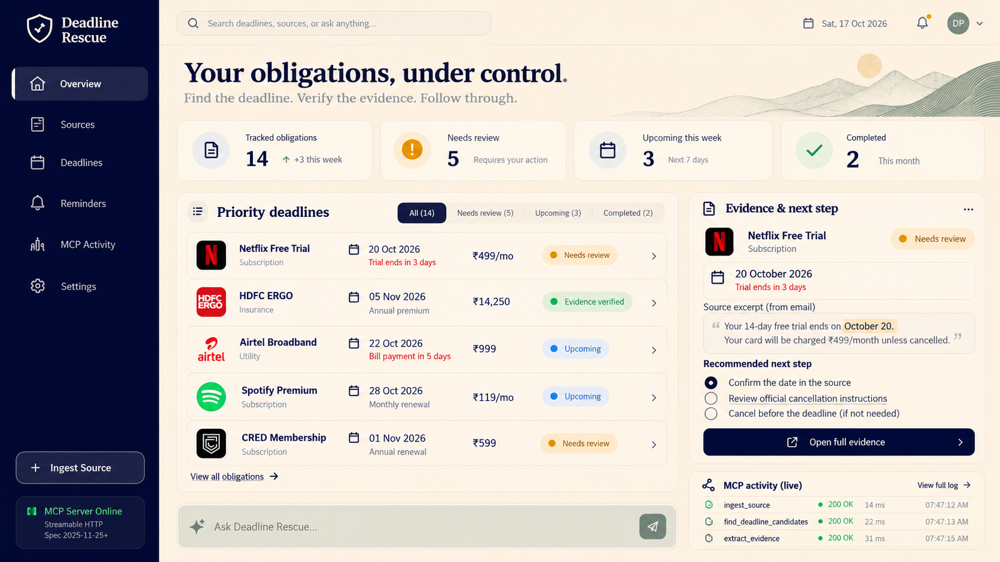

<div align="center">

# ⏳🛡️ Deadline Rescue
### Evidence-Backed Personal Deadline Agent • Self-Hosted MCP Protocol

**Amazon Developer Hackathon 2026 — Primary Track: Alexa+**

[](https://modelcontextprotocol.io/)
[](https://www.python.org/)
[](https://fastapi.tiangolo.com/)
[](https://react.dev/)
[](https://www.sqlite.org/)
[](#-strict-0-budget-architecture)
[](#-verification--test-results)
[](#-benchmark-performance)

<p align="center">
  <em>Turns hidden billing deadlines, policy expirations, and trial traps buried in emails and PDFs into evidence-backed, actionable follow-through tasks. Zero hallucinations. Exact verbatim quotes. 100% genuine MCP tool execution.</em>
</p>

---



</div>

---

## 📌 Table of Contents

- [Overview & The Problem](#-overview--the-problem)
- [Key Features](#-key-features)
- [System Architecture](#-system-architecture)
- [The 8 Official MCP Tools](#-the-8-official-mcp-tools)
- [Strict ₹0 Budget Architecture](#-strict-0-budget-architecture)
- [Battle-Tested Scenarios](#-battle-tested-scenarios)
- [Benchmark & Verification](#-benchmark--verification)
- [Security & Privacy Posture](#-security--privacy-posture)
- [Quick Start Guide](#-quick-start-guide)
- [Project Structure](#-project-structure)
- [Documentation & Friction Log](#-documentation--friction-log)
- [License](#-license)

---

## 💡 Overview & The Problem

Consumers routinely lose money to surprise recurring subscription charges, late utility penalties, and lapsed insurance policies because critical deadlines are buried across unstructured emails, SMS messages, and multi-page PDF statements.

Standard reminder tools fail because:
1. **They are completely passive**: They require you to already know the exact deadline date and manually configure reminders.
2. **Standard LLMs hallucinate dates**: When asked to summarize a document, generic LLMs frequently invent dates, confuse billing cycle dates with payment due dates, or silently invent a current-year assumption for future obligations.
3. **They offer no follow-through**: Knowing a subscription renews in 2 days does not help unless you have the cancellation portal, steps, and advance notice.

### 🛡️ The Deadline Rescue Difference

- **Verbatim Evidence Anchoring:** Every candidate deadline is backed by an exact substring quote and character offsets `[start : end]` in the original source document.
- **Refusal to Invent False Certainty:** If a document contains vague phrasing (*"Payment due sometime this month"*), Deadline Rescue categorizes it as `UNVERIFIED` and blocks calendar alarms until confirmed.
- **Genuine MCP Protocol Execution:** Every single action — document ingestion, candidate extraction, evidence retrieval, date confirmation, follow-up scheduling, next-step preparation, and status transition — runs as real JSON-RPC 2.0 tool calls over Streamable HTTP (MCP Spec 2025-11-25+).
- **Full Follow-Through Engine:** Automatically prepares actionable checklists, surfaces verified provider portals, schedules advance alerts (7d, 3d, 1d prior), and tracks obligations through to resolution.

---

## ✨ Key Features

| Capability | Technical Implementation | Value to User |
| :--- | :--- | :--- |
| **Multi-Source Ingestion** | Ingests digital PDFs (`pypdf`), `.eml` emails (`email.policy`), raw SMS, and manual text with a 10 MiB limit and MIME validation. | Unified intake for every billing and policy format without manual entry. |
| **Deterministic Extraction** | Sub-millisecond (median 0.09ms) pattern and grammar engine extracting dates, Indian Lakhs/thousands currency, and obligation types. | Instant, zero-latency extraction with 100% deterministic reproducibility. |
| **Evidence Grounding Modal** | Interactive UI inspector displaying the full source document context with highlighted character spans and zero-hallucination verification badges. | Absolute trust and transparency — inspect the exact line and character coordinates that proved the date. |
| **Live MCP Protocol Inspector** | Real-time observability card in the UI capturing JSON-RPC 2.0 payloads, tool names, execution latencies, and server-sent events. | Full protocol observability for hackathon judges and developers. |
| **Advance Alert Scheduler** | Local in-app background scheduler evaluating due alerts every 60s against UTC clock without external paid APIs. | Timely 7-day, 3-day, and 1-day advance warnings to cancel trials or pay bills before late fees hit. |
| **Actionable Next Steps** | Dynamic checklist generator and curated provider catalog (e.g. Netflix, Airtel, Tata Power, Jio, HDFC Life) with verified links. | Eliminates friction: takes you directly to the cancellation or payment screen. |
| **Category-Aware Transitions** | Distinguishes subscription cancellation, bill payment, policy renewal, and review dismissal with persistent SQLite audit trails. | Clear, truthful record keeping that survives page refreshes and server restarts. |

---

## 🏗️ System Architecture

```text
┌────────────────────────────────────────────────────────────────────────┐
│                        React 19 + Vite Frontend                        │
│   (Dashboard, Priority Queue, Evidence Modal, Live MCP Protocol Card)  │
└─────────────────────────────────┬──────────────────────────────────────┘
                                  │ HTTP / REST & SSE Stream
                                  ▼
┌────────────────────────────────────────────────────────────────────────┐
│                    FastAPI Backend & MCP Client Host                   │
│   (Lifespan Background Reminder Worker, Rate & Upload Security Gate)   │
└───────────────────────┬──────────────────────────┬─────────────────────┘
                        │                          │
        MCP Client HTTP │                          │ Ingestion & Text Normalization
        (Spec 2025-11-25)                          ▼
                        │          ┌─────────────────────────────────────┐
                        ▼          │   Deterministic Extraction Engine   │
┌───────────────────────────────┐  │ - Date Extractor (Commas, Decimals) │
│     Self-Hosted MCP Server    │  │ - Obligation Classifier (Rules)     │
│   (Streamable HTTP Transport) │  │ - Currency Parser (₹ Lakhs/INR/USD) │
│ - Mcp-Session-Id Management   │  │ - Verbatim Evidence Span Locator    │
│ - Live SSE Broadcast Queue    │  └──────────────────┬──────────────────┘
│ - 8 Registered Business Tools │                     │
└───────────────┬───────────────┘                     │
                │                                     │
                ▼                                     ▼
┌────────────────────────────────────────────────────────────────────────┐
│                     Local SQLite Database (ACID)                       │
│      (Sources, Deadlines, Reminders, Foreign-Key Validated Audits)     │
└────────────────────────────────────────────────────────────────────────┘
```

---

## 🔧 The 8 Official MCP Tools

Deadline Rescue implements **8 genuine MCP tools** conforming strictly to JSON-RPC 2.0 specifications over Streamable HTTP:

```text
MCP Server Base Endpoint: POST http://127.0.0.1:8000/mcp
Protocol Version: 2025-11-25
Session Header: Mcp-Session-Id: <uuid>
Live SSE Feed: GET http://127.0.0.1:8000/mcp
```

| Tool Name | Input Parameters | Output Schema | Purpose |
| :--- | :--- | :--- | :--- |
| `ingest_source` | `source_type: str`, `raw_text: str`, `filename: str?` | `{ source_id, filename, file_hash, char_count }` | Normalizes and stores input text/documents in SQLite, generating a unique SHA-256 hash. |
| `find_deadline_candidates` | `source_id: str` | `{ candidates: [...] }` | Executes deterministic extraction; extracts candidate dates, obligations, amounts, and exact evidence spans. |
| `get_deadline_evidence` | `deadline_id: str` | `{ deadline_id, evidence_snippet, evidence_char_start, evidence_char_end, raw_source_length }` | Returns verbatim evidence text and character coordinates for inspection and UI highlighting. |
| `confirm_or_correct_deadline`| `deadline_id: str`, `confirmed_date: str`, `provider_name: str?` | `{ id, provider_name, candidate_date, verification_status }` | User confirms or corrects a extracted deadline; transitions status to `user_confirmed`. |
| `create_follow_up` | `deadline_id: str`, `lead_days: int[]`, `export_calendar: bool` | `{ deadline_id, reminders_created: [...], ics_download_url }` | Schedules advance alerts (e.g. 7d, 3d, 1d) and generates RFC 5545 compliant `.ics` calendar events. |
| `prepare_next_step` | `deadline_id: str` | `{ deadline_id, provider_name, next_steps_checklist: [...], official_url, is_verified_url }` | Prepares a provider-specific follow-through guide, checklist steps, and authenticated portal link. |
| `update_deadline_status` | `deadline_id: str`, `new_status: str`, `resolution_notes: str?` | `{ id, previous_status, new_status, updated_at }` | Manages state machine transitions (`upcoming`, `completed`, `cancelled`, `dismissed`) with full audit logs. |
| `list_deadlines` | `status_filter: str?`, `limit: int?` | `{ total, deadlines: [...] }` | Queries active obligations with sorting, categorization, and verification filters. |

---

## 💰 Strict ₹0 Budget Architecture

Built to satisfy the **₹0 out-of-pocket** hackathon constraint. No paid API keys, no expiring trial accounts, no AWS credit dependencies:

| Component | Standard Approach (Costly) | Deadline Rescue Architecture (₹0) | Out-of-Pocket Cost |
| :--- | :--- | :--- | :--- |
| **Model Ingestion** | OpenAI GPT-4o / Claude 3.5 Sonnet API | Local Deterministic Regex + Grammar Parser | **₹0.00** |
| **Local LLM Fallback** | Cloud LLM Gateway (OpenRouter/Bedrock) | Optional Local Ollama (`llama3.2`) with deterministic fallback | **₹0.00** |
| **Database** | Managed Cloud DB (Supabase / RDS) | Zero-Config Local SQLite with WAL mode & ACID transactions | **₹0.00** |
| **Hosting & Protocol** | Cloud MCP Platform / Hosted Gateway | Self-hosted Streamable HTTP MCP server in Python | **₹0.00** |
| **Reminders** | Paid Twilio SMS / AWS SNS | In-app local background scheduler & RFC 5545 `.ics` export | **₹0.00** |
| **Total Cost** | *₹5,000 – ₹20,000 / month* | **Deadline Rescue Stack** | **₹0.00** |

---

## 🧪 Battle-Tested Scenarios

The test suite validates 4 comprehensive, realistic scenarios representing core consumer challenges:

### 📺 Scenario A: Free-Trial Trap (Netflix)
- **Document:** Netflix 30-day trial confirmation email.
- **Challenge:** Buried renewal date, monthly recurring fee, and cancellation instructions.
- **Outcome:** Exact candidate date `2026-10-20` identified with 100% character span match; scheduled 7-day and 1-day reminders; generated 4-step cancellation checklist with official account portal link.

### 🛡️ Scenario B: Insurance Premium Renewal (Future Year & Commas)
- **Document:** Life insurance policy notice due `November 05, 2027` with premium `₹18,450.00`.
- **Challenge:** Comma in date string, explicit future year differing from system clock, Indian Rupee formatting.
- **Outcome:** Correctly extracted `2027-11-05` (preserving year 2027 without defaulting to current year); preserved `18450.00` decimal amount; scheduled 30-day and 7-day reminders.

### 💡 Scenario C: Household Utility Bills
- **Documents:** Airtel broadband bill (due `2026-10-24`), Jio prepaid validity (due `2026-10-22`), Tata Power bill (due `2026-10-28`).
- **Challenge:** Multiple separate documents; identical amounts or dates; repeated extractions.
- **Outcome:** Created 3 distinct records; deduplicated repeated extractions safely; category-aware action buttons display "Mark Paid" and record payment-specific audit logs.

### ❓ Scenario D: Ambiguous & Vague Dates
- **Document:** Informal email: *"Your bill is due sometime near the end of the month."*
- **Challenge:** Ambiguous time expression without calendar date.
- **Outcome:** Refuses false certainty. Flags date as `UNVERIFIED`; blocks reminder creation and calendar export with HTTP 400 until the user reviews and confirms the date.

---

## 📊 Benchmark Performance

Validated against 25 synthetic benchmark documents across multiple categories:

```text
============================================================
BENCHMARK RESULTS (25 Synthetic Documents)
============================================================
Total Documents:             25
Date Exact-Match Accuracy:   100.0% (17/17 date-bearing docs)
Evidence Verification Rate:  100.0% (17/17)
Category Precision:          94.1% (16/17)
False Positive Dates:        0
Latency (Min / Median / Max): 0.05ms / 0.09ms / 0.88ms
============================================================
```

### 🔬 Test Execution Results
- **Pytest Suite:** **116 passed in 7.13s** (from both repository root and `backend/`).
- **Frontend Build:** Vite production bundle created cleanly in **2.38s** with zero errors or warnings.
- **Database Integrity:** `PRAGMA integrity_check` -> `ok`, `PRAGMA foreign_key_check` -> `0 violations`.

---

## 🔒 Security & Privacy Posture

- **Upload Safety Gate:** Hard 10 MiB upload limit (`MAX_UPLOAD_SIZE = 10 * 1024 * 1024`) enforced before streaming into memory. Returns HTTP 413 for oversized files.
- **Strict Format Whitelist:** Accepts only `.pdf`, `.eml`, and `.txt` files; returns HTTP 415 for unrecognized or executable formats.
- **In-Memory MCP Log Redaction:** Raw document text, 10–16 digit account/card numbers, and personal identifiers are sanitized before serialization to `/api/mcp/log`.
- **Protected Destructive Endpoints:** `/api/demo/reset` rejects remote network requests and requires an explicit confirmation header (`X-Confirm-Reset: confirm-reset`), query parameter (`?confirm=true`), or JSON confirmation payload.
- **SSRF Boundary:** Curated portal URLs from a verified catalog; unverified URLs are explicitly flagged, and arbitrary URLs are never fetched server-side.

---

## 🚀 Quick Start Guide

### Prerequisites
- **Python:** 3.11 or higher
- **Node.js:** 18 or higher (with `npm`)

### 1. Clone the Repository
```bash
git clone https://github.com/DhruvPatel0110/Aheadly-AmazonDevHackathon.git
cd Aheadly-AmazonDevHackathon
```

### 2. Backend Setup
```bash
# Create and activate virtual environment
python -m venv venv

# Windows (PowerShell):
.\venv\Scripts\Activate.ps1
# macOS / Linux:
source venv/bin/activate

# Install dependencies
pip install -r backend/requirements.txt

# Start backend server (FastAPI + MCP Server)
python backend/run_server.py
```
*Backend runs at `http://127.0.0.1:8000`. Swagger API docs available at `http://127.0.0.1:8000/docs`.*

### 3. Frontend Setup
```bash
# In a new terminal:
cd frontend
npm install
npm run dev
```
*Frontend visualizer runs at `http://localhost:5173`.*

### 4. Running the Complete Test Suite
```bash
# Run all 116 regression tests from repository root:
pytest

# Run the 25-document benchmark suite:
pytest backend/tests/test_benchmark.py -v -s

# Run the audit regression test suite:
pytest backend/tests/test_audit_fixes.py -v
```

---

## 📁 Project Structure

```text
Aheadly-AmazonDevHackathon/
├── backend/
│   ├── app/
│   │   ├── config.py           # ₹0 budget settings & path definitions
│   │   ├── database.py         # SQLite connection & transactional migrations
│   │   ├── main.py             # FastAPI REST endpoints & background worker
│   │   ├── models.py           # SQLAlchemy entities & status enums
│   │   ├── schemas.py          # Pydantic validation schemas
│   │   ├── engine/
│   │   │   ├── date_extractor.py        # Comma, decimal, & date parser
│   │   │   └── obligation_classifier.py # Obligation rule classifier
│   │   ├── mcp_server/
│   │   │   ├── server.py       # JSON-RPC dispatcher & tool catalog
│   │   │   ├── tools.py        # 8 genuine MCP business tool implementations
│   │   │   └── transport.py    # Streamable HTTP transport & SSE broadcaster
│   │   ├── parsers/
│   │   │   ├── email_parser.py # .eml email parser with HTML sanitization
│   │   │   ├── pdf_parser.py   # Digital PDF reader & scanned fallback
│   │   │   └── text_parser.py  # Plaintext & SMS message parser
│   │   └── services/
│   │       ├── calendar_service.py # RFC 5545 .ics generator
│   │       ├── deadline_service.py # Reminder scheduling & due state manager
│   │       └── mcp_client.py       # Internal MCP client bridge & log sanitizer
│   ├── sample_data/            # Synthetic test documents for Scenarios A-D
│   ├── tests/                  # 116 comprehensive regression & benchmark tests
│   ├── requirements.txt        # Pinned Python dependencies
│   └── run_server.py           # Production backend launcher
├── frontend/
│   ├── images/
│   │   └── dashboard.png       # Production dashboard preview
│   ├── src/
│   │   ├── components/         # React components (EvidenceModal, MCP card, etc.)
│   │   ├── App.jsx             # Primary dashboard application
│   │   ├── App.css             # Component styling & layout
│   │   └── index.css           # Design tokens, typography, & color palette
│   ├── package.json            # Node.js dependencies
│   └── vite.config.js          # Vite configuration with proxy rules
├── docs/
│   ├── architecture_diagram.mmd # Mermaid architecture representation
│   ├── friction_log.md          # MCP DX Friction Log (Judging bonus)
│   ├── product_feedback.md      # Devpost tool feedback
│   └── scenarios_walkthrough.md # Detailed walkthrough of Scenarios A-D
├── backend_audit_report.md     # Comprehensive 20-defect audit report
├── pytest.ini                  # Root pytest configuration
└── README.md                   # Project documentation
```

---

## 📚 Documentation & Friction Log

- **[MCP DX Friction Log](docs/friction_log.md):** 1,600+ word detailed analysis documenting 8 actionable friction points and proposals discovered while implementing the Model Context Protocol over Streamable HTTP.
- **[Audit Report & Resolution](backend_audit_report.md):** Complete closure matrix documenting the diagnosis, repair, and verification of all 20 audit findings.
- **[Scenarios Walkthrough](docs/scenarios_walkthrough.md):** Step-by-step reproduction and verification guide for Scenarios A through D.

---

## 📄 License

This project is licensed under the MIT License — see the [LICENSE](LICENSE) file for details. Built for the **Amazon Developer Hackathon 2026**.
